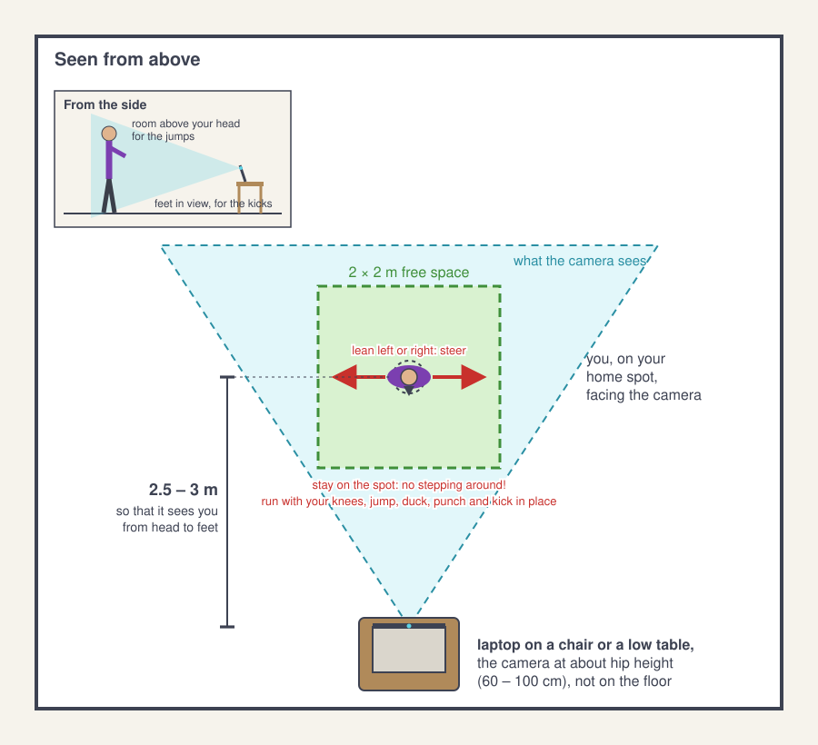

# Auslender

**Auslender** — A satirical, motion-controlled action and fitness game inspired by the Swiss cult character Müslüm.
Using real-time body-pose estimation, you box, race, sledge and run through worlds inspired by his songs: steer a car with an invisible wheel, push a sledge down the glacier with your arms, jump and duck over the ice, and punch, kick and dodge your way past mammoths and sabre-toothed tigers, evil scientists at the fictional pharma giant Rochartis, Nörgeli, and hordes of Bünzlis and nationalists.
No controllers, no walking around — just your body on one spot and your Üsländer power!

See [DESIGN.md](DESIGN.md) for the game design, and [CONTRIBUTING.md](CONTRIBUTING.md) for how to develop it, and how to record more moves and retrain the move classifier.

**No network access.**
The game runs entirely on your computer and works offline.
The webcam images are processed locally, in memory, and are never saved or sent anywhere.

## Setting up

* **Put the laptop on a chair or a low table, so that the camera is at about the height of your hips (60 to 100 cm).**
  Do not put it on the floor: the camera would look steeply up at you, and leaning or stepping forward would move your head up and down in the picture, which looks like a duck or a jump.
* **Stand 2.5 to 3 m away from the camera, facing it.**
  The camera must see all of you, from your head to your feet (for the kicks), with some room above your head (for the jumps).
* **Clear a space of about 2 × 2 m around you.**
* **Stay on your spot.**
  The spot where you stand at the start is your home spot: hold still there for a second, and the game remembers it.
  You never need to walk: you lean, duck, jump, punch and kick on the spot.

You need a webcam which supports 640x480.
